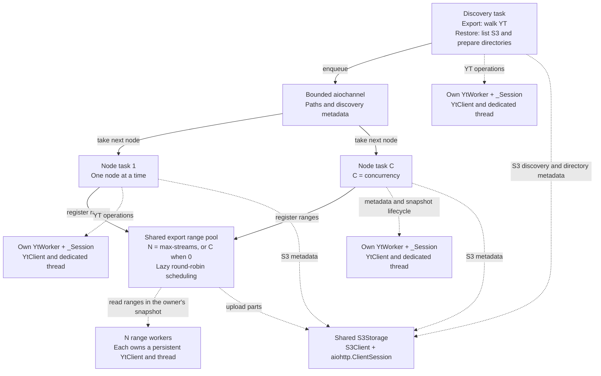
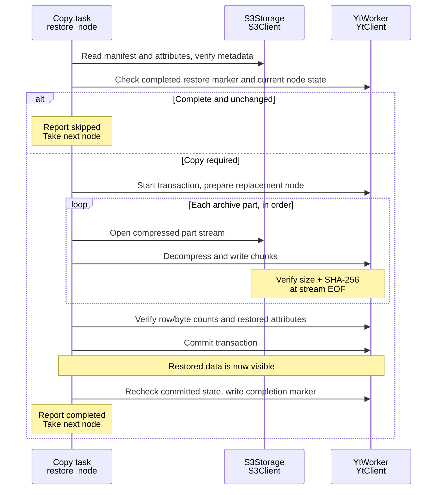

# Architecture

[README](README.md) · [Usage reference](USAGE.md) · [Development](CONTRIBUTING.md)

This document describes the archive format, change detection and node lifecycle.
The execution diagrams follow one table through export or restore. Files use the
same pipeline with bytes instead of rows; documents carry a complete YSON value
and directories carry metadata.

## Storage

```text
s3://my-bucket/export/
└── home/analytics/events/
    ├── @manifest.json
    ├── @generations/<directory-generation>/
    │   └── @attributes.yson
    └── 2026-01-01/
        ├── @manifest.json
        └── @generations/<table-generation>/
            ├── @attributes.yson
            └── @data/
                ├── part-000000.yson.zst
                └── part-000001.yson.zst
```

Each generation ID is a random UUID represented by 32 lowercase hexadecimal
digits. The node manifest declares that generation and references only its exact
attributes and ordered part keys. Generation objects are immutable; only the
node's `@manifest.json` is replaced when publishing an update.

Tables use binary YSON row fragments compressed with Zstandard. Files use compressed
byte ranges (`.bin.zst`). Documents use exactly one binary YSON node compressed
with Zstandard (`@data/part-000000.yson.zst`), including empty maps/lists and entity
values. Their `data_size` is the serialized uncompressed byte count and `row_count`
is zero; `--part-size-mib` does not split documents. Parts decompress independently.
Directories and empty tables/files retain metadata without data parts. Node names are percent-encoded
in S3 keys. Unicode, spaces and literal percent signs are supported. This version
rejects YT selectors and names containing `\`, `[]{}<>&*@`; it never follows links.

YSON preserves schemas, byte strings, unsigned integers, and attributed values.
Saved metadata includes user attributes and, for tables, `schema`,
`compression_codec`, `erasure_codec`, `optimize_for`; files preserve their codecs
and optional `file_name`/`executable`. Ownership, ACLs, placement and expiration
settings are excluded. The user attribute `yt_s3_state` is reserved for completion
metadata. Directory attributes are updated without removing unrelated children;
replacing a directory with a table, file or document, or vice versa, is rejected.

The archive format identifier is `yt-s3-v2`; older formats are rejected by both
export and restore. Re-export the source to a new archive prefix rather than
updating an old archive in place. The restore completion attribute remains
`yt_s3_state`, and fingerprints include the new format identifier. Only document
manifests extend `encoding` with `documents: binary_yson_node`.

Documents are read through `/@value` under the same snapshot lock as their metadata.
Node attributes are read separately through `/@`, so attributes on the YSON value
cannot be confused with Cypress node metadata. Documents are buffered and parsed
as a whole, unlike streamed table/file parts. They are intended for small metadata;
very large documents require memory proportional to their serialized value and
parsed YSON tree.

## Detecting changes

For **YT -> S3**, discovery reads child IDs, types and revisions together with
each directory listing. A worker can skip a node without another YT request when
its ID, `content_revision`, `attribute_revision` and copy settings match the
manifest and all referenced S3 objects exist with their recorded sizes.
Directories are still traversed; their content revision is ignored when comparing
their own metadata.

If this check cannot establish a match, the worker opens a snapshot and compares
the full fingerprint: source cluster, node ID, content revision, a hash of the
saved attributes (including schema), and archive encoding settings. A mismatch
requires copying. The manifest's revisions come from the snapshot actually copied.

When source revision metadata needs refreshing but the full fingerprint is
unchanged, only the manifest is conditionally updated after successful snapshot
completion; data is not uploaded again. Subsequent runs can use the listing check.

A fast skip reflects the state observed during discovery; changes after that
observation are picked up on a later run. Revision-based detection assumes writers
do not use `suppress_modification_tracking`: changes made with revision tracking
disabled may go undetected. `content_revision` is a YT revision, not a hash of rows.

For **S3 -> YT**, completion metadata on the destination node records the source
manifest's fingerprint. Skipping also requires verifying that the destination's
data, schema, and saved attributes have not changed since import. The marker stores destination
node ID, committed content revision and a hash of portable attributes. It is
written after commit, after checking that chunk IDs and attributes still match
the completed write. For documents, a SHA-256 digest of canonical binary YSON
(including value attributes) is checked before and after commit instead of chunk
IDs. Restore validates the declared payload size, complete YSON syntax and storage
checksum before setting the document value. A matching marker alone is insufficient;
if unchanged state cannot be established, copy again.

Skipping compares metadata; it is not a full integrity scan of stored data. Part
checksums verify data as it is transferred.

## Completion and replacement

The manifest records the generation, source fingerprint, attributes object, and
ordered data parts, with sizes and checksums. Without a manifest, an S3 node is
incomplete. A directory manifest confirms its own metadata, not completion of its
descendants.

S3 keeps **one current generation, without version history**. Export reads the
existing manifest and its ETag before opening the source snapshot, including
direct `export_node` calls without discovery. It then writes a unique generation
while retaining the old manifest and objects. Once every upload and the source
snapshot have succeeded, it atomically publishes the manifest with `If-Match` for
that ETag, or `If-None-Match: *` if the node had no manifest. Metadata-only manifest refreshes
use the same conditional publication protocol.

Concurrent exporters write different generations. Only a writer whose expected
manifest still matches can publish; a conflict fails that node without overwriting
the winner. The writer does not automatically rebase an older snapshot onto a
newer manifest. A lost publication acknowledgement is checked against the stored
manifest, and an unresolved outcome retains the uploaded objects. These guarantees
require the S3 backend to honor conditional PUTs and provide atomic object
visibility with ETags; they are not implied merely by an S3-compatible API.

After confirmed publication, export immediately deletes only the attributes and
parts referenced by the exact manifest it replaced. It never deletes all
generations except the current one: those might belong to another active writer.
A cleanup failure is a warning and does not invalidate the published backup.
Crashes, failed or conflicted uploads, uncertain publication outcomes, and
interrupted cleanup can leave unused generations. There is no automatic global
garbage collection or TTL. A later export only cleans its direct predecessor.
Unknown unfinished S3 multipart uploads also require a bucket lifecycle rule or
manual cleanup.

Restore keeps the manifest selected when classifying each node through directory
preparation and queued restoration. It does not reread the manifest between these
steps, so a concurrent type change cannot silently skip the selected root or its
children. A concurrent export can delete the selected generation before restore
finishes; missing objects fail the restore and roll back its unfinished node.
Restore does not automatically switch generations. Rerun it to select the current
manifest.

YT destinations use a transaction per node to avoid exposing partial tables, files
or documents. When a table, file or document needs copying, an existing destination
node is removed and recreated inside that transaction using only the portable
archive attributes.
Its previous ACL, owner and account are not preserved; YTsaurus creation defaults
and inheritance rules apply. Unchanged nodes are skipped without replacement.
Existing directories are updated in place, keeping their identity, non-portable
settings and unrelated children while replacing their portable attributes.

Consistency is per node; a directory tree is not a single
point-in-time snapshot. Moving or replacing directories during a copy can change
which children are discovered; rerun after such changes to reconcile the tree.

## Execution

The runtime below describes `ytclone`; see the [parallel export reference](USAGE.md#parallel-export)
for coordinator scheduling and process recovery in `ytclone-parallel`.

```text
Discover -> bounded queue -> compare metadata -> skip or copy -> complete node
```

- Discovery and transfer overlap; copying starts before the entire tree is scanned.
- One discovery worker feeds an `aiochannel` bounded by `--queue-size`; at most
  `--concurrency` node lifecycles are active at once.
- Export has one fixed pool of `--max-streams` range workers per process, with
  `0` resolving to `--concurrency`. One static table can fill the pool. Registered
  nodes supply ranges lazily in round-robin order; files and documents allow only
  one active range each. There are no tasks or readers allocated for every part.
  Restore still transfers each node's parts sequentially.
- Buffers are bounded per active stream. Increasing `--max-streams` increases
  export buffer and reader memory; `--concurrency` separately controls the number
  of open node lifecycles and snapshots.
- Cypress discovery resolves the source root once, then lists each directory by
  ID with child IDs, types, revisions and source sizes. The queue carries these
  hints with each path; matching archives need no per-node YT requests. Workers
  validate current source paths before opening snapshots for full checks or copies.
  Discovery holds one directory listing per active tree level. Listings
  are limited to 1,000,000 immediate children; an incomplete listing fails
  explicitly. Restore remembers prepared directory paths and streams S3 listings.
- Tables stream as binary YSON without client-side row parsing. The engine
  retries failed table parts; file reads retain the SDK byte-offset retries.

### Runtime: tasks and their clients



Solid arrows carry paths and, during export, discovered IDs and revisions.
Dotted arrows show which clients a task uses.

- A **node task** is the async `worker()` loop in `engine.py`. It takes a path,
  copies or skips that node, then takes the next path. It owns the snapshot
  transaction and publishes the manifest only after the snapshot succeeds.
- A **`YtWorker`** is an async interface to one synchronous YT client.
  `_Session.call()` runs blocking SDK calls and compression in its dedicated thread.
- **`YtAdapter.worker()`** creates and closes this client/thread pair. Node tasks
  keep it across nodes; full checks and copies use separate node transactions, while
  revision-matched export skips need none. The SDK manages HTTP sessions
  and transaction pings. An uncertain transaction cleanup prevents client reuse.
- **`PartPool`** in `export_pool.py` owns N async range workers. Each creates its
  YT client/thread pair on its first assignment and reuses it until pool shutdown.
  Readers use the node owner's snapshot; they do not own its transaction or pings.
  A worker holds its range through read, compression, S3 upload, and part retries.
- **S3 clients are shared** across all tasks and use async HTTP. Export bytes
  flow through range workers, without going through the node queue.

When a range fails, its node stops supplying new ranges. The node waits for all
its active ranges to finish cleanup before leaving the snapshot. Global
cancellation follows the same ordering before closing the pool and clients.
Successful parts are ordered by range index in the manifest, regardless of their
completion order. Parts of an interrupted node are not durable resume checkpoints.

`ytclone-parallel` creates one pool per worker process. Its coordinator assigns
whole nodes to processes; a single table never spans their pools.

Restore uses the node task's client directly and does not use the range pool.
Its discovery finishes each parent directory before queuing its children. Clients
and dedicated threads close when their tasks finish.

### Export: one table from YT to S3

```mermaid
sequenceDiagram
    participant D as Discovery task
    participant W as Copy task<br/>export_node
    participant Y as Node owner<br/>YtWorker
    participant P as Shared PartPool<br/>Range readers
    participant S as S3Storage<br/>S3Client

    D-->>W: Enqueue path, ID, type and revisions from LIST
    W->>S: Read manifest and ETag once
    alt Revisions and copy settings match
        W->>S: Check referenced object sizes
    end
    alt Complete and unchanged at discovery
        Note over W: Report skipped without YT requests
    else Full check required
        W->>Y: Start transaction, lock snapshot, read metadata
        Note over W,S: Compare full fingerprint; reuse manifest and prior size checks
        alt Full fingerprint matches and objects exist
            W->>Y: Successfully finish snapshot transaction
            opt Snapshot revision is missing or outdated in manifest
                W->>S: Refresh manifest conditionally on its ETag
            end
            Note over W: Report skipped
        else Copy required
            W->>S: Upload attributes to a new unique generation
            Note over W,S: Keep the previous manifest and generation available
            W->>P: Register lazy ranges and shared snapshot
            loop Concurrent ranges, up to the shared stream limit
                P->>P: Read snapshot range, compress with zstd
                P->>S: Upload generation part, record size and SHA-256
                opt Temporary table-read failure
                    P->>S: Abort unfinished multipart upload
                    P->>P: Reopen the same range in the same snapshot
                    Note over P,S: Retry the whole part, up to 3 attempts
                end
            end
            P-->>W: All ranges complete, results in range order
            W->>Y: Successfully finish snapshot transaction
            W->>S: Publish manifest with If-Match, or create-only
            alt Publication confirmed
                Note over W,S: The new archive generation is complete
                W->>S: Delete exact references from the replaced manifest
                Note over W,S: Cleanup failure warns; the published backup remains valid
            else Conflict or unresolved publication
                Note over W,S: Fail node; retain uploaded objects
            end
        end
    end
```

An archive part is one S3 object. S3 multipart upload chunks are buffers within
that object. Parts are streamed through bounded buffers.

`YtWorker.read_part()` opens one fresh stream and compressor using the supplied
snapshot. Table reads use the
SDK HTTP transport, preserving its framing and trailer error checks, without the
SDK row parser. `copy_part()` retries only `RetryableReadError`, raised by the YT
adapter for temporary table-read failures. S3 request retries stay in `S3Storage`;
cancellation and permanent errors are not retried by `copy_part()`.

### Restore: one table from S3 to YT



An error before commit aborts the replacement. The completion marker is written
**after** commit: if that step fails, data may already be restored, but the node
is reported failed and a repeated run can copy it again.

## Where to look in the code

| File | Responsibility |
| --- | --- |
| [engine.py](src/ytclone/engine.py) | `_pipeline`: queue and task lifetimes. `export_node` / `restore_node`: copying one node. `copy_part`: retrying a streamed part. |
| [export_pool.py](src/ytclone/export_pool.py) | `PartPool`: fixed range workers, lazy fair scheduling, node failure and cancellation draining. |
| [yt.py](src/ytclone/yt.py) | `YtAdapter`: worker factory. `YtWorker`: YT operations. `_Session`: client, thread and transaction lifecycle. |
| [s3.py](src/ytclone/s3.py) | Object reads, multipart writes, integrity checks and cleanup. |
| [format.py](src/ytclone/format.py) | Archive paths, manifests, fingerprints and range planning. |
| [codec.py](src/ytclone/codec.py) | Async S3 input made readable by the synchronous YT writer. |
| [interfaces.py](src/ytclone/interfaces.py) | Contracts for substituting adapters in tests. |
| [cli.py](src/ytclone/cli.py) | Arguments, shared S3 client and dependency wiring. |
