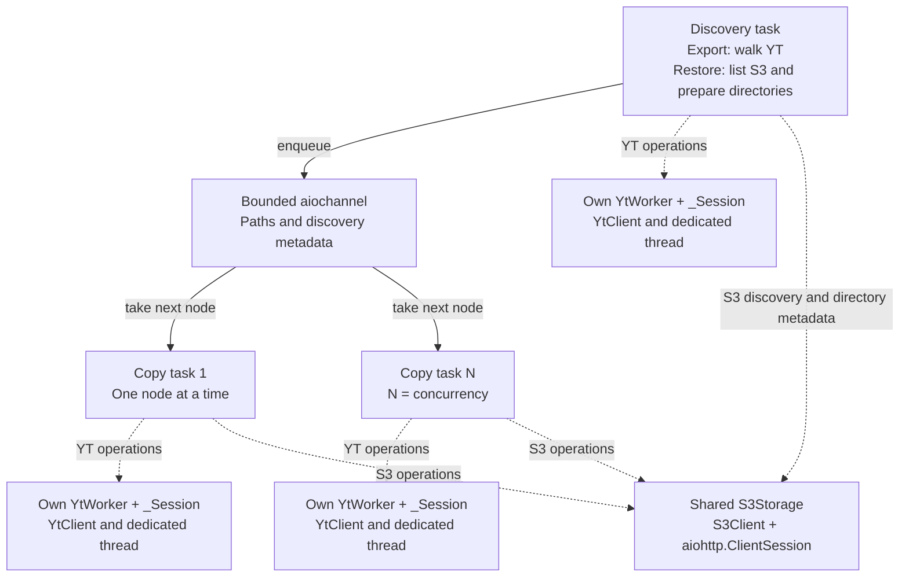
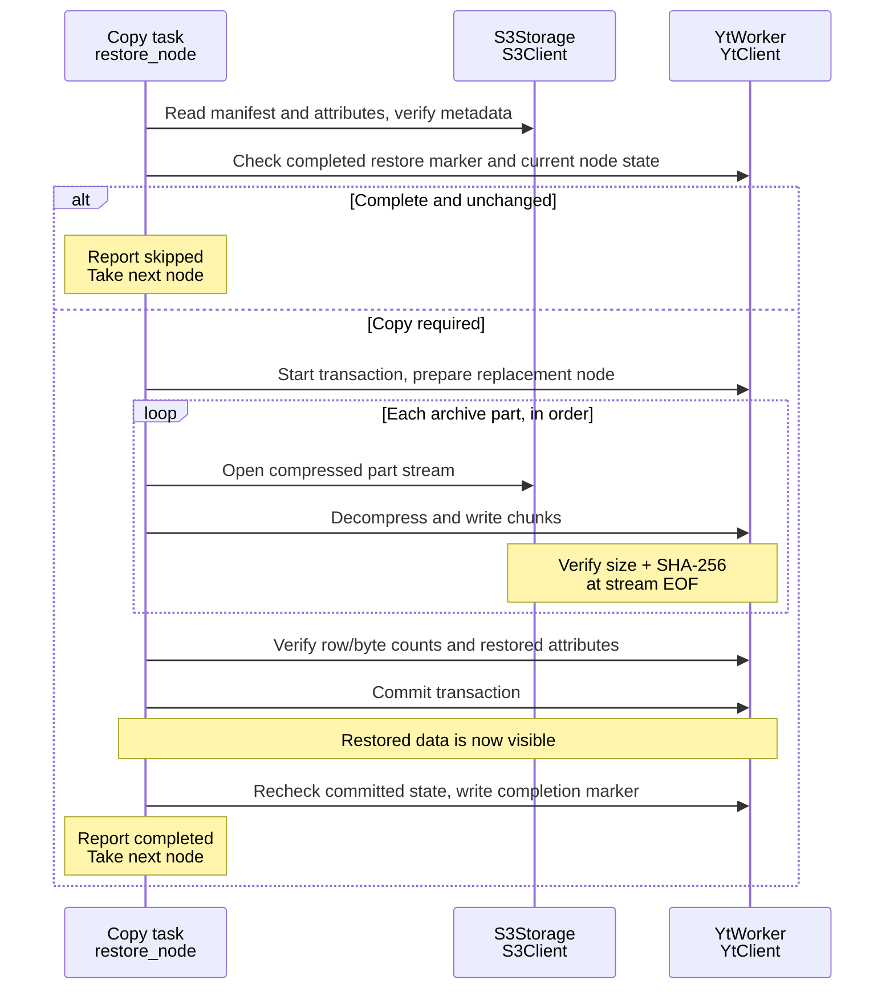

# Architecture

[README](README.md) · [Usage reference](USAGE.md) · [Development](CONTRIBUTING.md)

This document describes the archive format, change detection and node lifecycle.
The execution diagrams follow one table through export or restore. Files use the
same pipeline with bytes instead of rows; documents carry a complete YSON value
and directories carry metadata.

## Storage

```text
s3://my-bucket/export/
└── home/analytics/events/
    ├── @attributes.yson
    ├── @manifest.json
    └── 2026-01-01/
        ├── @attributes.yson
        ├── @manifest.json
        └── @data/
            ├── part-000000.yson.zst
            └── part-000001.yson.zst
```

Tables use binary YSON row fragments compressed with Zstandard. Files use compressed
byte ranges (`.bin.zst`). Documents use exactly one binary YSON node compressed
with Zstandard (`@data/part-000000.yson.zst`), including empty maps/lists and entity
values. Their `data_size` is the serialized uncompressed byte count and `row_count`
is zero; `--part-size-mib` does not split documents. Parts decompress independently.
Directories and empty tables/files retain metadata without data parts. Node names are percent-encoded
in S3 keys. Unicode, spaces and literal percent signs are supported. This version
rejects YT selectors and names containing `\`, `[]{}<>&*@`; it never follows links.

YSON preserves schemas, byte strings, unsigned integers, and attributed values.
Saved metadata includes user attributes and, for tables, `schema`,
`compression_codec`, `erasure_codec`, `optimize_for`; files preserve their codecs
and optional `file_name`/`executable`. Ownership, ACLs, placement and expiration
settings are excluded. The user attribute `yt_s3_state` is reserved for completion
metadata. Directory attributes are updated without removing unrelated children;
replacing a directory with a table, file or document, or vice versa, is rejected.

The archive format identifier remains `yt-s3-v1`, and the restore completion
attribute remains `yt_s3_state`. Both names are retained for compatibility with
existing archives and restored nodes created by `yt-s3`. Only document manifests
extend `encoding` with `documents: binary_yson_node`; existing kinds keep their
encoding and fingerprints unchanged. New readers accept old archives; old readers
reject document manifests and cannot fully restore a tree containing documents.

Documents are read through `/@value` under the same snapshot lock as their metadata.
Node attributes are read separately through `/@`, so attributes on the YSON value
cannot be confused with Cypress node metadata. Documents are buffered and parsed
as a whole, unlike streamed table/file parts. They are intended for small metadata;
very large documents require memory proportional to their serialized value and
parsed YSON tree.

## Detecting changes

For **YT -> S3**, discovery reads child IDs, types and revisions together with
each directory listing. A worker can skip a node without another YT request when
its ID, `content_revision`, `attribute_revision` and copy settings match the
manifest and all referenced S3 objects exist with their recorded sizes.
Directories are still traversed; their content revision is ignored when comparing
their own metadata.

If this check cannot establish a match, the worker opens a snapshot and compares
the full fingerprint: source cluster, node ID, content revision, a hash of the
saved attributes (including schema), and archive encoding settings. A mismatch
requires copying. The manifest's revisions come from the snapshot actually copied.

Older manifests without `attribute_revision` use this full check. If unchanged,
only the manifest is updated after successful snapshot completion; data is not
uploaded again. Subsequent runs can use the listing check.

A fast skip reflects the state observed during discovery; changes after that
observation are picked up on a later run. Revision-based detection assumes writers
do not use `suppress_modification_tracking`: changes made with revision tracking
disabled may go undetected. `content_revision` is a YT revision, not a hash of rows.

For **S3 -> YT**, completion metadata on the destination node records the source
manifest's fingerprint. Skipping also requires verifying that the destination's
data, schema, and saved attributes have not changed since import. The marker stores destination
node ID, committed content revision and a hash of portable attributes. It is
written after commit, after checking that chunk IDs and attributes still match
the completed write. For documents, a SHA-256 digest of canonical binary YSON
(including value attributes) is checked before and after commit instead of chunk
IDs. Restore validates the declared payload size, complete YSON syntax and storage
checksum before setting the document value. A matching marker alone is insufficient;
if unchanged state cannot be established, copy again.

Skipping compares metadata; it is not a full integrity scan of stored data. Part
checksums verify data as it is transferred.

## Completion and replacement

The manifest records the source fingerprint and references the attributes object
and ordered data parts, with sizes and checksums. It is written last: without it,
an S3 node is incomplete. A directory manifest confirms its own metadata, not
completion of its descendants.

S3 keeps **one current copy, without version history**. Replacing a node removes
its manifest before changing data and publishes a new manifest when finished.
The node is unavailable during replacement, and a failed replacement may lose the
previous complete copy. Reading a node while it is being replaced, or writing it
from multiple processes at once, is not supported.

A successful replacement removes obsolete parts for that node. An interruption
can leave data without a manifest or unfinished S3 multipart uploads; these need
a retry or cleanup.

YT destinations use a transaction per node to avoid exposing partial tables, files
or documents. When a table, file or document needs copying, an existing destination
node is removed and recreated inside that transaction using only the portable
archive attributes.
Its previous ACL, owner and account are not preserved; YTsaurus creation defaults
and inheritance rules apply. Unchanged nodes are skipped without replacement.
Existing directories are updated in place, keeping their identity, non-portable
settings and unrelated children while replacing their portable attributes.

Consistency is per table or file; a directory tree is not a single
point-in-time snapshot. Moving or replacing directories during a copy can change
which children are discovered; rerun after such changes to reconcile the tree.

## Execution

The runtime below describes `ytclone`; see the [parallel export reference](USAGE.md#parallel-export)
for coordinator scheduling and process recovery in `ytclone-parallel`.

```text
Discover -> bounded queue -> compare metadata -> skip or copy -> complete node
```

- Discovery and transfer overlap; copying starts before the entire tree is scanned.
- One discovery worker feeds an `aiochannel` bounded by `--queue-size`; at most
  `--concurrency` nodes are transferred at once. Each node's parts are sequential.
  Buffers are bounded per transfer; increasing concurrency increases memory use.
- Cypress discovery resolves the source root once, then lists each directory by
  ID with child IDs, types, revisions and source sizes. The queue carries these
  hints with each path; matching archives need no per-node YT requests. Workers
  validate current source paths before opening snapshots for full checks or copies.
  Discovery holds one directory listing per active tree level. Listings
  are limited to 1,000,000 immediate children; an incomplete listing fails
  explicitly. Restore remembers prepared directory paths and streams S3 listings.
- Tables stream as binary YSON without client-side row parsing. The engine
  retries failed table parts; file reads retain the SDK byte-offset retries.

### Runtime: tasks and their clients



Solid arrows carry paths and, during export, discovered IDs and revisions.
Dotted arrows show which clients a task uses.

- A **copy task** is the async `worker()` loop in `engine.py`. It takes a path,
  copies or skips that node, then takes the next path.
- A **`YtWorker`** is that task's async interface to one synchronous YT client.
  `_Session.call()` runs blocking SDK calls and compression in its dedicated thread.
- **`YtAdapter.worker()`** creates and closes this client/thread pair. It is kept
  across nodes; full checks and copies use separate node transactions, while
  revision-matched export skips need none. The SDK manages HTTP sessions
  and transaction pings. An uncertain transaction cleanup prevents client reuse.
- **S3 clients are shared** across all tasks and use async HTTP. Table/file bytes
  flow inside a copy task, without going through the node queue.

During restore, discovery finishes each parent directory before queuing its
children. Clients and dedicated threads close when their tasks finish.

### Export: one table from YT to S3

```mermaid
sequenceDiagram
    participant D as Discovery task
    participant W as Copy task<br/>export_node
    participant Y as YtWorker<br/>YtClient
    participant S as S3Storage<br/>S3Client

    D-->>W: Enqueue path, ID, type and revisions from LIST
    W->>S: Read manifest once
    alt Revisions and copy settings match
        W->>S: Check referenced object sizes
    end
    alt Complete and unchanged at discovery
        Note over W: Report skipped without YT requests
    else Full check required
        W->>Y: Start transaction, lock snapshot, read metadata
        Note over W,S: Compare full fingerprint; reuse manifest and prior size checks
        alt Full fingerprint matches and objects exist
            W->>Y: Successfully finish snapshot transaction
            opt Snapshot revision is missing or outdated in manifest
                W->>S: Refresh only the manifest
            end
            Note over W: Report skipped
        else Copy required
            W->>S: Delete old manifest, upload attributes
            loop Each archive part, in order
                W->>Y: Read snapshot range, compress with zstd
                Y-->>W: Stream compressed chunks
                W->>S: Upload part, record size and SHA-256
                opt Temporary table-read failure
                    W->>S: Abort unfinished multipart upload
                    W->>Y: Reopen the same range in the same snapshot
                    Note over W,S: Retry the whole part, up to 3 attempts
                end
            end
            W->>Y: Successfully finish snapshot transaction
            W->>S: Remove obsolete parts of this node
            W->>S: Write manifest last, with snapshot revisions
            Note over W,S: The archive node is complete
        end
    end
```

An archive part is one S3 object. S3 multipart upload chunks are buffers within
that object. Parts are streamed through bounded buffers.

`Snapshot.read_part()` opens one fresh stream and compressor. Table reads use the
SDK HTTP transport, preserving its framing and trailer error checks, without the
SDK row parser. `copy_part()` retries only `RetryableReadError`, raised by the YT
adapter for temporary table-read failures. S3 request retries stay in `S3Storage`;
cancellation and permanent errors are not retried by `copy_part()`.

### Restore: one table from S3 to YT



An error before commit aborts the replacement. The completion marker is written
**after** commit: if that step fails, data may already be restored, but the node
is reported failed and a repeated run can copy it again.

## Where to look in the code

| File | Responsibility |
| --- | --- |
| [engine.py](src/ytclone/engine.py) | `_pipeline`: queue and task lifetimes. `export_node` / `restore_node`: copying one node. `copy_part`: retrying a streamed part. |
| [yt.py](src/ytclone/yt.py) | `YtAdapter`: worker factory. `YtWorker`: YT operations. `_Session`: client, thread and transaction lifecycle. |
| [s3.py](src/ytclone/s3.py) | Object reads, multipart writes, integrity checks and cleanup. |
| [format.py](src/ytclone/format.py) | Archive paths, manifests, fingerprints and range planning. |
| [codec.py](src/ytclone/codec.py) | Async S3 input made readable by the synchronous YT writer. |
| [interfaces.py](src/ytclone/interfaces.py) | Contracts for substituting adapters in tests. |
| [cli.py](src/ytclone/cli.py) | Arguments, shared S3 client and dependency wiring. |
